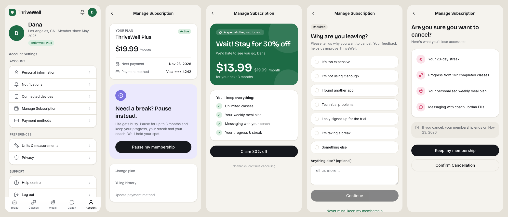

# ThriveWell: Re:Design starter

This is the **as-is** version of ThriveWell, a made-up subscription wellness app. It has fitness classes, meal planning and coaching. The cancellation flow is just as frustrating as the business brief describes.

Your job in the Re:Design program is to **redesign that cancellation flow**. This repository is your starting point. You'll make your own copy, run it, and change it into your team's solution.



> 📄 **Read the brief first:** [docs/brief.md](docs/brief.md)
> 🧭 **Walkthrough of the current flow:** [docs/current-flow.md](docs/current-flow.md)
> 🌱 **New to code, Git or the terminal?** Start with [docs/beginners-guide.md](docs/beginners-guide.md). It goes step by step.

---

## 1. Get your own copy

You'll want your own copy on GitHub so that your work stays yours after the program ends.

1. Sign in to [github.com](https://github.com). Create a free account if you don't have one.
2. On this repository's page, click the green **Use this template** button, then **Create a new repository**.
3. Give it a name, for example `thrivewell-redesign-yourname`, and click **Create repository**.

You now have your own copy, completely separate from the original. Nothing you do can break anyone else's.

## 2. Run it

Choose **one** of these options.

### Option A: in your browser, nothing to install (easiest)

1. On **your** repository's page, click **Code** → **Codespaces** → **Create codespace on main**.
2. Wait a minute or two while it sets up. The app starts by itself and opens in a preview tab.
3. If the preview doesn't open, click the **Ports** tab at the bottom and open the address next to port **5173**.

GitHub gives every account free Codespaces hours each month, which is plenty for this program. When you're done for the day, stop the codespace from [github.com/codespaces](https://github.com/codespaces).

### Option B: on your own computer

You need **Node.js** (version 20.19 or newer) and **Git**. [The beginner's guide](docs/beginners-guide.md) shows how to install both.

```bash
git clone https://github.com/YOUR-USERNAME/YOUR-REPO-NAME.git
cd YOUR-REPO-NAME
npm install      # only the first time: downloads what the app needs
npm run dev      # starts the app and opens it in your browser
```

To stop the app, click in the terminal and press `Ctrl + C`. To start it again later, run `npm run dev`.

📱 **To try it on your phone:** when `npm run dev` is running, the terminal shows a `Network:` address such as `http://192.168.1.20:5173`. Open that address on your phone. Your phone must be on the same Wi-Fi.

## 3. Try the current flow

1. Go to **Account**, then **Manage Subscription**, and try to cancel.
2. Count the screens and time it. The brief's benchmark is a median of **4–6 screens and about 3 minutes**. Measure your redesign the same way.
3. Refresh the page to reset the demo, so the subscription is active again.

**Testing as a different persona:** the app shows **Dana** by default. To test as **Marcus** (Colorado) or **Priya** (Texas), open [src/data/personas.ts](src/data/personas.ts), change `DEFAULT_PERSONA` at the bottom to `'marcus'` or `'priya'`, and save.

## 4. Where things live

| I want to change… | Look in |
|---|---|
| **The cancellation steps** (remove, reorder, rename) | [src/cancellation-flow/flow.config.ts](src/cancellation-flow/flow.config.ts) ← start here |
| The Manage Subscription screen (pause offer, faint cancel link) | [src/cancellation-flow/ManageSubscription.tsx](src/cancellation-flow/ManageSubscription.tsx) |
| One cancellation screen (discount, survey, confirm) | [src/cancellation-flow/steps/](src/cancellation-flow/steps/) |
| The screens shown at the end (cancelled, paused…) | [src/cancellation-flow/OutcomePage.tsx](src/cancellation-flow/OutcomePage.tsx) |
| Different rules for different US states | [src/state-rules/stateRules.ts](src/state-rules/stateRules.ts) |
| Account Settings list | [src/screens/Account.tsx](src/screens/Account.tsx) |
| The personas (Dana, Marcus, Priya) | [src/data/personas.ts](src/data/personas.ts) |
| Colours, fonts, corner radius | [src/styles/index.css](src/styles/index.css) |
| Other screens (Today, Classes, Meals, Coach) | [src/screens/](src/screens/) |
| Buttons, cards, inputs (shadcn/ui building blocks) | [src/components/ui/](src/components/ui/) |
| Which screen appears at which address | [src/App.tsx](src/App.tsx) |

### Quick experiments to get comfortable

Open [src/cancellation-flow/flow.config.ts](src/cancellation-flow/flow.config.ts), make one of these changes and save. The app updates instantly.

- **Rename the entry point:** change `'Manage Subscription'` to `'Cancel or pause subscription'`.
- **Remove the survey:** delete the line `'reason-survey',` from `cancellationSteps`.
- **Make the survey optional:** set `surveyRequired: false`.

Then run through the flow again and count the screens.

## 5. Built with

- **[React](https://react.dev)** for the screens, written in TypeScript (`.tsx` files).
- **[shadcn/ui](https://ui.shadcn.com)** for the buttons, cards, drawers and other ready-made components. They're copied into `src/components/ui/`, so you can open and change them.
- **[Tailwind CSS](https://tailwindcss.com)** for styling. The class names such as `rounded-xl bg-card p-4` describe the look directly in the code.
- **[Lucide](https://lucide.dev/icons)** for icons. Browse the site, then use an icon by name, e.g. `import { Heart } from 'lucide-react'`.
- **[Vite](https://vite.dev)** runs the app while you work.

There's **no real backend**. All the data is made up, and refreshing the page resets everything.

**Adding more shadcn/ui components:** run `npx shadcn@latest add <name>`, for example `npx shadcn@latest add checkbox`. You'll find the full list at [ui.shadcn.com/docs/components](https://ui.shadcn.com/docs/components).

## 6. Working with an AI assistant

You're encouraged to use Claude, Cursor, Copilot or similar tools. This repo includes an [AGENTS.md](AGENTS.md) file that tells AI tools how the project is organised, so they give better help. Some prompts to try:

- *"Explain what happens, file by file, when I tap Cancel subscription."*
- *"Rename Manage Subscription to Cancel or pause subscription and make Cancel a clear button instead of a grey link."*
- *"Add a new cancellation step that offers to switch to a cheaper plan. Use shadcn/ui components and follow the existing step files."*
- *"Use src/state-rules/stateRules.ts so users in Colorado skip the discount offer."*

**Tip:** ask for one change at a time, check the result in the browser, then save your work (below) before the next change.

## 7. Save your work

Saving a file only changes it on the computer you're working on. To store a version on GitHub, you **commit** (take a snapshot) and **push** (upload it).

- **In Codespaces or VS Code:** open the **Source Control** panel (the branching icon on the left), type a short message such as `Remove survey step`, click **Commit**, then **Sync / Push**.
- **In the terminal:**
  ```bash
  git add .
  git commit -m "Remove survey step"
  git push
  ```

Commit often. Each commit is a checkpoint you can go back to.

## 8. Share your version

To get a link you can send to your team or put in a presentation:

1. Go to [vercel.com](https://vercel.com) and sign up with your GitHub account. It's free.
2. Click **Add New → Project** and pick your repository.
3. Leave all the settings as they are and click **Deploy**.

After a minute you'll have a public link. Every time you push a change, the link updates automatically. [Netlify](https://netlify.com) works the same way (build command `npm run build`, publish folder `dist`).

## 9. Troubleshooting

| Problem | Try this |
|---|---|
| `npm: command not found` | Node.js isn't installed. See [the beginner's guide](docs/beginners-guide.md#2-install-nodejs). |
| Error mentioning the Node version | Install the current LTS version from [nodejs.org](https://nodejs.org). |
| `Port 5173 is in use` | The app is already running in another terminal. Use that one, or close it with `Ctrl + C`. |
| The page is blank or shows an error | Read the terminal; it usually names the file and line. Undo your last change, or ask your AI assistant to explain the error. |
| The app is in a strange state | Refresh the page. |
| Something is very broken | In Source Control, discard your changes since the last commit. Or in the terminal: `git restore .` |
| Missing packages after pulling changes | Run `npm install` again. |

Useful commands:

| Command | What it does |
|---|---|
| `npm run dev` | Start the app while you work |
| `npm run build` | Build the app for sharing (what Vercel runs) |
| `npm run check` | Check the code for type mistakes |

---

### For facilitators

- Turn on **Settings → General → Template repository** for this repo, so the **Use this template** button appears.
- The as-is flow follows the brief step by step. [docs/current-flow.md](docs/current-flow.md) lists where the app had to fill in details the brief doesn't give, plus two points in the brief worth clarifying with participants.
