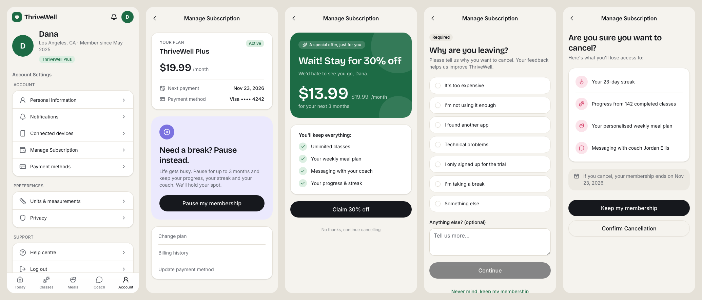

# The current (as-is) cancellation flow

This page shows how each step in the brief appears in the app, and which file to open to change it.

## Step by step

| # | What the brief says | What you see in the app | File |
|---|---|---|---|
| 1 | User finds **"Manage Subscription"** in Account Settings. It's not labelled "Cancel", on purpose. | **Account** tab → a settings list. "Manage Subscription" sits in the middle of the *Account* group, between "Connected devices" and "Payment methods". | [Account.tsx](../src/screens/Account.tsx), label set in [flow.config.ts](../src/cancellation-flow/flow.config.ts) |
| 2 | A **"Pause Instead"** offer comes first; **Cancel** is a secondary, less prominent link. | The plan card, then a large lilac "Need a break? Pause instead." card with a black button. "Cancel subscription" is small, light grey text at the very bottom of the page. | [ManageSubscription.tsx](../src/cancellation-flow/ManageSubscription.tsx) |
| 3 | A **discount offer**: "Stay for 30% off your next 3 months". | A green offer card with the discounted price. "Claim 30% off" is the big button; "No thanks, continue cancelling" is tiny grey text. | [steps/DiscountOffer.tsx](../src/cancellation-flow/steps/DiscountOffer.tsx) |
| 4 | A **mandatory survey** before the cancel button becomes active. | "Why are you leaving?" with a *Required* badge. **Continue** stays greyed out until a reason is picked. | [steps/ReasonSurvey.tsx](../src/cancellation-flow/steps/ReasonSurvey.tsx) |
| 5 | Only then does **"Confirm Cancellation"** appear. | "Are you sure?" with a list of what you'll lose. **Keep my membership** is the main black button; **Confirm Cancellation** is the outlined secondary one. | [steps/ConfirmCancel.tsx](../src/cancellation-flow/steps/ConfirmCancel.tsx) |
| ✓ | — | A result screen: cancelled, paused, discount applied or kept. | [OutcomePage.tsx](../src/cancellation-flow/OutcomePage.tsx) |

Counting from Account Settings, cancelling takes **5 screens**. That's within the brief's "median of 4–6 screens".

## The known problems, and where to see them

| Problem from the brief | Where to see it in the app |
|---|---|
| "Couldn't find cancel" / "a maze" | No "Cancel" wording anywhere in Account Settings; the cancel link is small, grey text at the bottom of the page. |
| 4–6 screens, ~3 minutes | Count the screens and time yourself going from Account to the result screen. |
| Random survey answers | The survey is required and blocks progress, so picking any answer is the fastest way through. |
| Same flow everywhere | [stateRules.ts](../src/state-rules/stateRules.ts) exists but nothing uses it. Marcus (Colorado) gets exactly the same flow as Priya (Texas). |
| Chargebacks after failed cancellations | Not simulated. |

## Details the app had to fill in

The brief doesn't describe everything, so these parts were invented to make the app work. Teams can change any of them.

- **The pause flow:** "Pause my membership" leads to a single screen to choose 1, 2 or 3 months, then a confirmation.
- **When access ends after cancelling:** at the end of the current billing period.
- **What happens after accepting the discount:** the discount is applied straight away and the user lands on a "Discount applied!" screen.
- **The survey reasons:** a plausible list, editable in `flow.config.ts`.
- **Prices:** ThriveWell Plus is $19.99/month, so the 30% offer is $13.99/month.

## Two points in the brief worth discussing

These came up while building the app. They're worth raising early with your team or a facilitator.

1. **"Abandon partway" and churn.** The brief says about a third of the 4.2% churn comes from users who *abandon* the flow partway. But users who abandon haven't cancelled in the app. One reading: they give up and then cancel some other way, for example by disputing the charge with their bank. That connects to the chargeback problem.
2. **Dana's pause story.** Dana "gave up after the third retention screen" while trying to *pause*. But in the flow described, the pause option is the first thing shown. Perhaps she didn't see the pause option and went down the cancel path instead, or perhaps the pause path has its own friction. That's a useful research question.
